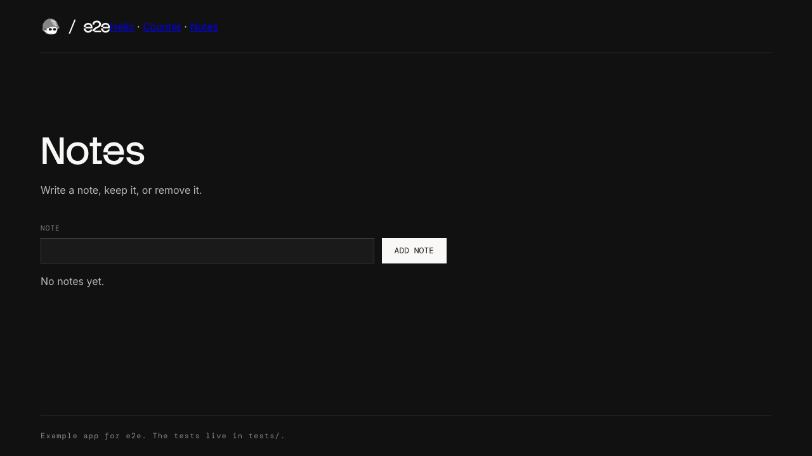

# TesterArmy e2e with coverage-based test selection

This is [tester-army/e2e](https://github.com/tester-army/e2e)'s `with-vite`
example, run on a local model through Ollama and narrowed by
[Variance Authority](https://github.com/Variance-Authority), a CLI and a set of
test-runner hooks that select tests by recorded coverage. Each run records which lines of the app every test entered. The next
run executes only the spec files whose recorded lines changed.

An agentic test pays a model for every judgment, so a test that does not run
is tokens and minutes not spent. Here is an edit to the counter's click handler,
on a cold agent cache:

| | Spec files | Tests | Model calls | Tokens | Wall time |
| --- | ---: | ---: | ---: | ---: | ---: |
| Whole suite | 6 | 12 | 17 | 62.6k | 5m 16s |
| Selected | 2 | 3 | 3 | 10.1k | 44s |

The cache matters: e2e can replay an agent step it has seen before without
calling the model, and these numbers start without one. The selected run kept `counter.e2e.ts` and `counter.agent.e2e.ts`. An edit to
the notes' `remove` handler keeps only `notes.agent.e2e.ts`, since no
deterministic test removes a note. A comment-only edit skips everything,
because the code the browser runs is unchanged.

## Run it

```bash
ollama pull qwen3:30b-a3b
npm install
npm run test:e2e
```

The first run records. Edit something under `src/features/` and run again.
`E2E_MODEL` picks another Ollama model, `VARIANCE_AUTHORITY_SINCE=` (empty)
runs the whole suite, and `npm run test:e2e:headed` opens the browser while
it runs.

`npm run showcase` regenerates everything under [What a run shows](#what-a-run-shows).
It needs a clean tree: an uncommitted edit to the config runs the whole suite.

## What a run shows

Each run leaves two accounts: e2e's of what the agent did, and Variance
Authority's of which code each test ran. `npm run showcase` records the
whole suite, makes this edit, and runs what selection keeps:

```diff
   function remove(index: number) {
-    setNotes(notes.filter((_, at) => at !== index));
+    setNotes((current) => current.filter((_, at) => at !== index));
   }
```

### Which tests run, and why

`npx variance select` reads the edit against the recording and names the spec
files to leave out ([`reports/select.txt`](reports/select.txt)):

```text
skipping 5 of 6 test files recorded whole: none covered a changed line; every other test file runs.
read src/features/Notes.tsx: bodies — the changed regions are charged, not the whole module
```

`npx variance covering --since HEAD` says who stands behind each changed
region, and calls a test the only witness when no other test ran it
([`reports/covering-since.txt`](reports/covering-since.txt)):

```text
  15-17 function Notes/remove — 1 case, and it is the only witness
    tests/notes.agent.e2e.ts > the agent removes a note
```

One agentic test is all that checks `remove`. The deterministic suite never
removes a note, so without the agent this edit ships unchecked.

### Which test runs each line

`npx variance covering --file src/features/Notes.tsx` maps the whole file
([`reports/covering-notes.txt`](reports/covering-notes.txt)). It marks a range
`walked` when tests ran it, `alone` when one test did, and `unwalked` when none
did. Two stand out:

```text
line 10 — unwalked
lines 15-17 — alone
  tests/notes.agent.e2e.ts
    the agent removes a note
```

Line 10 is `if (value === '') return;`: no test adds an empty note. Lines 15-17
are `remove`, with the single witness above.

### What the agent did

e2e writes a trace page for every test. Here is the agent removing a note
([`reports/remove-a-note.md`](reports/remove-a-note.md)):

```text
2. ✓ agent.act "add a note that says {text}, then remove it" (3 model calls)
   - type "call mum" into textbox "Note" (39ms)
   - tap button "Add note" (35ms)
   - tap button "Remove call mum" (32ms)
   - screen: unchanged since step 1 at /notes
4. ✓ agent.assert "there are no notes left" (1 model call)
```

And the screen its judgment was about:



The run summaries e2e writes as `.e2e/summary.md` are in
[`reports/full-run.md`](reports/full-run.md) and
[`reports/selected-run.md`](reports/selected-run.md). Both ran on a warm replay
cache, which is why the whole suite there costs about the same as the
selection: the one test selection keeps is the one the cache cannot replay.

## How it is wired

- `vite.config.ts` adds `testSelectionProbes()`, so the dev server serves
  instrumented source.
- `variance/test.ts` extends e2e's `test` with a fixture that drains the
  page's coverage after each attempt, under that attempt's id.
- `variance/reporter.ts` maps each attempt to its test and spec file from the
  run's report. It records one entry per spec file for selection and one per
  test for `covering`. A file with a failed test is recorded incomplete, and an
  incomplete file always runs.
- `variance/select.ts` asks `variance select` once, in the main process. The
  config turns each skipped file into a `!` exclude in `tests`.

`e2e.config.ts`, `vite.config.ts` and `variance/test.ts` are preconditions of
every spec file, so an edit to one of them runs the whole suite.

`variance/test.ts` reads the running attempt from e2e's internal
`Symbol.for('e2e.attempt.v1')`, the only place a fixture can learn which test it
belongs to. That is why `e2e` and `@e2e-dev/web` are pinned exactly.

## History of adoption

### How it works

Selection needs two facts: what a test ran, and what an edit changed. Git owns
the second; the browser owns the first. A spec file is skipped only when its
recording is complete and none of its recorded regions changed. Anything the
recording cannot vouch for runs: a file with a failed test, a file never
recorded, a change to the config every test depends on. Selection can only make
a run smaller by being sure, never by guessing.

### How we made it work

We started from upstream's `with-vite` example with one change: the agent is
`qwen3:30b-a3b` on Ollama instead of a hosted model. A single page with one
test file gives selection nothing to skip, so the app became three routed
features (a greeting, a counter, notes), each with a deterministic and an
agentic spec file.

Coverage came first. `testSelectionProbes()` in the Vite config instruments
the source, and a `test.extend` fixture drains the page after `use()`. The
fixture then needs to know which test it served, and e2e does not tell
fixtures that. It does keep the running attempt in a global symbol for
`expect.poll`, so the fixture reads that and stages the coverage under the
attempt id. The reporter joins attempt ids to spec files through the report e2e
hands `onRunFinished`.

Selection came second. e2e forks workers that each load `e2e.config.ts` again,
so asking `variance select` from the config would ask once per worker. The
first load asks and puts the answer in the environment, and workers inherit
it. The `tests` globs reject character classes, so each skipped file becomes
its own `!` exclude.

The local model needed room. Three workers sharing one Ollama made judgments
queue past e2e's 30-second default, so `judgmentTimeout` is two minutes and the
test timeout five.

The first selected run executed every file. That was correct: the edit that
wired selection in had touched `e2e.config.ts`, which every test depends on
without importing it. It is declared a precondition, and it runs everything
whenever it changes.

Last came the readings. Recording each test as well as each file lets
`variance covering` name a test per line. e2e's `trace: 'on'` and `markdown`
reporter give the agent's side. We tried e2e's video too. The screencast
takes frames on its own clock, the agent's actions finish in about 100ms, and
a minute and a half of recording never showed the note, so the example keeps
none.

### What's missing

From e2e, for this to be a package rather than an example:

- **A public way for a fixture to know its test.** The attempt id comes from an
  internal symbol, so any e2e release can break it.
- **A hook that runs once before workers start.** Selection rides an
  environment variable set by whichever process loads the config first.
- **A filter hook in the config.** File excludes are the only lever, so
  selection is per spec file. With a filter it could be per test.
- **A replay for an act that ends where it began.** Adding and removing a note
  leaves the screen unchanged, so e2e records nothing to replay, and that step
  calls the model every run. It is also the one test this edit selects.
- **A shared replay cache.** `.e2e/cache` is ignored by git, so CI starts cold
  every time. A cold run is where selection saves the most, as in the table at
  the top.

From Variance Authority:

- **`variance story` for a browser test.** The command draws one test's route through
  the code, but only Vitest and Jest record stories. The browser collector
  drains coverage, not the order things ran in.

### What else we can do

- **Point the agent at unwalked code.** `covering` lists the lines no test
  ran, like line 10 above. `e2e explore` is an agent looking for problems, so
  the unwalked ranges can be its goal.
- **Run the lone witnesses first.** A region with one witness has no other test
  to catch a break there. Running those files first is an ordering we have not
  measured here.
- **Carry the recording in CI.** `variance carry` is the command that moves the
  recording between jobs, so a pull request selects against the main branch's record instead of
  running everything.
- **Give the judge the screen.** Judgments read the accessibility tree unless
  `vision` is set. A vision model on Ollama, such as `gemma4`, can judge what
  the page looks like.

## License

Apache-2.0, as the e2e example it starts from. See `NOTICE`.
